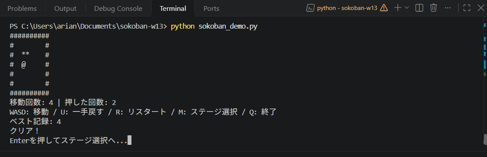

# 倉庫番（Sokoban）改良版

## ゲームの概要
プレイヤー（@）を操作して箱（$）を押し、すべての箱をゴール（.）に運ぶパズルゲームです。
ターミナル上で文字（ASCII）を使って遊びます。授業で配布された倉庫番をもとに、3つの機能を追加しました。

| 記号 | 意味 |
|---|---|
| `#` | 壁 |
| `@` | プレイヤー（ゴール上では `+`） |
| `$` | 箱（ゴール上では `*`） |
| `.` | ゴール |

## 動作環境
- Python 3.x
- 外部ライブラリは不要（標準ライブラリの `json` のみ使用）
- Windows のターミナル（PowerShell / コマンドプロンプト）で動作確認済み

## インストール方法
    git clone https://github.com/g026c1144-tech/sokoban-w13.git
    cd sokoban-w13

## 起動方法
    python sokoban_demo.py

※ 環境によっては `py sokoban_demo.py` を使用してください。
※ `sokoban_exercise.py` は第13回の演習用ファイルです。改良版は `sokoban_demo.py` です。

## 操作方法
キーを入力して Enter を押します。

| キー | 動作 |
|---|---|
| W / A / S / D | 上 / 左 / 下 / 右へ移動 |
| U | 一手戻す |
| R | ステージをやり直す |
| M | ステージ選択メニューに戻る |
| Q | 終了 |

**ルール：** 箱は押すことしかできません（引くことはできません）。箱の先に壁や別の箱がある場合は押せません。すべての箱をゴールに運ぶとクリアです。

## 追加・改良した機能

### 改良機能01：デッドロック（詰み）検出
- ゴール以外の箱が「角」（上下どちらかと左右どちらかが壁）に入ると、もう動かせないため警告を表示します。
- 関数：`is_deadlocked(game)`（新規）、`main()`（変更）

### 改良機能02：押した回数の表示とベスト記録の保存
- 箱を押した回数を数えて表示します。U（一手戻す）でも正しく元に戻ります。
- クリア時の移動回数が過去の記録より少ない場合、「新記録」として `best_records.json` に保存します。ゲームを終了しても記録は残ります。
- 関数：`load_records()`・`save_records()`（新規）、`load_level()`・`move_player()`・`undo()`・`draw_game()`・`main()`（変更）

### 改良機能03：ステージ選択メニュー
- 起動時にステージ一覧と各ステージのベスト記録を表示し、遊ぶステージを選べます。
- クリア後はメニューに戻ります。プレイ中は M キーでメニューに戻れます。メニューで Q を入力すると終了します。
- 範囲外の番号や文字を入力した場合は、再入力を求めます。
- 関数：`select_level(records)`（新規）、`main()`・`draw_game()`（変更）

## スクリーンショット

## 既知の問題・制限事項
- デッドロック検出は「角」に入った箱のみを判定します。壁際に並んだ箱など、その他の詰み状態は検出できません。
- ベスト記録は実行したフォルダーの `best_records.json` に保存されます。このファイルは Git の管理対象外です。
- ステージは3つです。

## クレジット
- ベースプログラム：プログラミング演習1（Web技術演習）第13回 配布の倉庫番デモ版
- 改良：Ariana Sheikhi